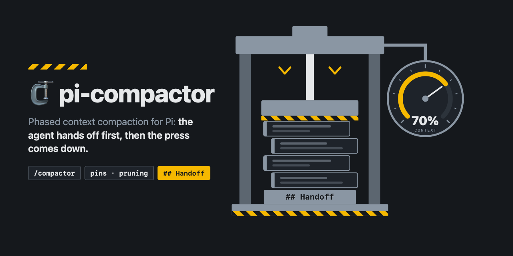

# 🗜️ pi-compactor



Phased context compaction for Pi: the agent hands off first, then the press comes down.

pi-compactor is an extension for [Pi](https://github.com/earendil-works). When the context gets full, pi-compactor waits for a safe moment, asks the agent to hand off its state, and then compacts. The handoff survives compaction and the agent picks up where it left off.

```
soft threshold → (prune old tool outputs) → wait for a safe point → preflight: agent calls compaction_ready
              → compact with the configured strategy → resume if work was interrupted
```

## Install

```sh
pi install npm:pi-compactor
```

## How it works

1. **Pruning.** When usage crosses `softThreshold`, large old tool outputs are replaced with a short stub. Superseded file reads go first, then the largest outputs. The last `pruning.keepRecentTurns` turns are never touched. If pruning brings usage back under the threshold, nothing else happens.
2. **Safe point.** Compaction never interrupts important work. `safePoint` decides when it may run:
   - `settle` (default): only when the agent has finished.
   - `turn`: between turns, but not while tool calls from that turn are still pending.
   - `any`: at any boundary.

   Critical sections (see below) also defer it. Deferral is bounded: at `hardThreshold`, or once the context has grown by `maxDeferTokens`, the cycle proceeds anyway.
3. **Preflight.** The agent receives hidden instructions to finish or pause, save what must persist, and call `compaction_ready({ handoff })`. Preflight is bounded by `preflight.maxTurns` and `preflight.budgetTokens`. If either limit is reached, compaction runs without a handoff.
4. **Compaction.** The route depends on the runtime (`ctx.mode`). The cut keeps about Pi's `compaction.keepRecentTokens` of recent context, and the summary follows the strategy.
   - Interactive (TUI) and RPC: Pi's own compaction (`ctx.compact`), once the agent has settled, or at a turn end (aborting that turn) when the hard limit leaves no headroom. Pi fires `session_before_compact` and `session_compact`, so extensions that listen to them (memory extensions, for example) see the compaction. If the cycle interrupted the work, a hidden resume message is sent as a follow-up when the compaction completes.
   - Print and JSON: written as a boundary entry while the run settles (or at a turn end), because the runtime exits as soon as the prompt resolves and would abort a fire-and-forget compaction. No `session_compact` is fired. If the cycle interrupted the work, a hidden resume message follows the compaction and the run continues in the same prompt.

   `/compactor now` while idle always uses Pi's own compaction.

Pi's own threshold compaction is cancelled while pi-compactor still has headroom. Overflow compaction is never cancelled.

### Strategies

| Strategy | What survives |
| --- | --- |
| `summary` | LLM summary of the discarded part + recent messages |
| `hybrid` (default) | Handoff + contributions + LLM summary + recent messages |
| `handoff-only` | Handoff + contributions only; no previous messages are kept and no LLM call is made. Without a handoff it falls back to `hybrid` and records the fallback. |

Every strategy also keeps pins verbatim (the original request, user corrections, manual pins) and the cumulative lists of read and modified files.

## Footer status

With a UI, the footer always shows a `🗜️` status (status key `compactor`). The distance is measured against your own `softThreshold` for the current model, not Pi's built-in threshold.

| State | Text |
| --- | --- |
| Idle, usage known | `🗜️ 620k to compact` (tokens left until `softThreshold` of the model's window; `999`, `620k`, `1.2M`) |
| Idle, at or past the threshold | `🗜️ due 82%` |
| Cycle running | `🗜️ pending 75%`, `preflight 75%`, `compacting 75%` or `cooldown 75%` |
| Automatic compaction off (`enabled: false`, `/compactor off`) | `🗜️ off` |
| Right after a compaction, until Pi reports usage again | `🗜️ compacted from 208k` (`🗜️ compacted` when the size is unknown) |
| Usage not known yet (other cases) | `🗜️ measuring` |

It updates at each turn end and settle, on session start and model change, and after every `/compactor` command (including settings and on/off).

## Commands

| Command | Effect |
| --- | --- |
| `/compactor` or `/compactor status` | Phase, usage, thresholds, critical sections, last compaction metrics, settings warnings |
| `/compactor now` | Start a cycle now (preflight, then compact) |
| `/compactor on` / `off` | Enable or disable automatic compaction for this project (`.pi/compactor.json`) |
| `/compactor plan` | Describe what the next compaction would do, without doing it |
| `/compactor pin <text>` | Pin text that survives every compaction in this session; `pin` alone lists pins |
| `/compactor settings` | Interactive editor for every setting |

Pins are session entries and Pi cannot remove them; a new session starts without pins.

## Settings

Edit every setting with `/compactor settings`. You first pick a scope: global, project, or the current model in either file. The editor validates values and shows the effective value next to the scope's own value; *Reset* makes a key inherit from the lower layer again.

Precedence: defaults < global < project < global model override < project model override.

The editor writes these files, which are storage only:

- Global: `~/.pi/agent/extensions/pi-compactor/config.json`
- Project: `.pi/compactor.json`

Per-model overrides live under `"models": { "provider/modelId": { ... } }`. Invalid values are ignored with a warning. A `softThreshold` that is not below `hardThreshold` is adjusted to `hardThreshold - 5`.

| Key | Default | Meaning |
| --- | --- | --- |
| `enabled` | `true` | Compact automatically |
| `softThreshold` | `70` | Context % that starts a cycle |
| `hardThreshold` | `90` | Context % that stops waiting for a safe point |
| `strategy` | `hybrid` | `summary`, `hybrid`, `handoff-only` |
| `safePoint` | `settle` | `settle`, `turn`, `any` |
| `maxDeferTokens` | `20000` | Most the context may grow while waiting |
| `summaryModel` | `null` | `provider/modelId` for summaries; `null` uses the session model |
| `preflight.enabled` | `true` | Ask the agent for a handoff first |
| `preflight.maxTurns` | `3` | Max agent turns for preflight |
| `preflight.budgetTokens` | `8000` | Max tokens preflight may add |
| `preflight.template` | `null` | Custom instructions; placeholders `{{percent}}`, `{{reason}}`, `{{strategy}}`, `{{steps}}` |
| `pruning.enabled` | `true` | Prune old large tool outputs first |
| `pruning.minToolResultTokens` | `2000` | Smallest output that may be pruned |
| `pruning.keepRecentTurns` | `3` | Recent turns never pruned |
| `pins.originalRequest` | `true` | Keep the original request verbatim |
| `pins.userCorrections` | `true` | Keep discarded user messages verbatim (newest first, within budget) |
| `pins.maxTokens` | `4000` | Budget for pins |

## Agent tools

- `compaction_ready({ handoff })`: hands off state during preflight. The handoff must not be empty.
- `compaction_defer({ active, reason? })`: starts or ends a critical section that compaction waits for.

## Extension protocol

The protocol runs over `pi.events` and does not depend on any particular extension. Listeners must act synchronously.

```ts
// Add preflight steps and handoff text.
pi.events.on("compactor:collect", (p) => {
  p.contribute({ source: "my-ext", steps: ["Flush the queue"], handoff: "Queue: 3 jobs pending" });
});

// Open and close a critical section.
pi.events.emit("compactor:defer", { source: "my-ext", active: true, reason: "migration" });
pi.events.emit("compactor:defer", { source: "my-ext", active: false });

// After each compaction: reason, why, strategy, handoff, tokensBefore and compactor (details).
pi.events.on("compactor:done", (metrics) => { /* ... */ });
```

## Development

```sh
npm test   # node --test, no Pi install needed (fake Pi API)
```

`prototype/retain-none.test.ts` pins the Pi behavior that `handoff-only` relies on: a compaction whose `firstKeptEntryId` is `null` keeps nothing. Run it with `PI_CODING_AGENT=<path to pi-coding-agent> node --test prototype/`.

## License

MIT
